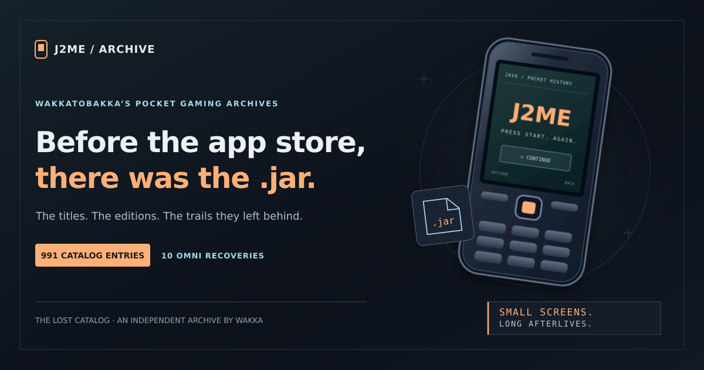

# J2ME / The Lost Catalog

**Before the app store, there was the .jar.**

[**Browse the J2ME archive →**](https://wakkatobakka.github.io/j2me-archive/) · [Wakka’s recoveries](https://wakkatobakka.github.io/j2me-archive/recovered/) · [Sources and credits](https://wakkatobakka.github.io/j2me-archive/sources/)

Created and maintained by **Wakkatobakka**. A source-linked catalog of **991 entries**, starting with the ten J2ME games recorded in the public Omni Player guide and reaching into a much larger paper trail.

## Explore the catalog

- **991 individual pages:** 989 titles explicitly listed in My Abandonware’s J2ME directory, plus two additional Omni recovery titles.
- **10 Omni recovery records,** preserving the input editions, filenames where recorded, source status, and remaining uncertainties.
- Search by title, alias, source credit, handset, resolution, language, or edition label; filter by year and genre.
- Source-scoped bibliographic tables and handset/version/language records, with links back to the original listings.
- A separate **16,548-record reference library** from My Abandonware, Kahvibreak, and RG-Backup.
- A separate **7,427-entry file inventory**: source-listed JARs, JAD descriptors, and 25 archive-package references.
- [Catalog CSV](data/catalog.csv), [catalog JSON](data/catalog.json), and [field definitions](data/README.md).

## What the records establish

This is a metadata catalog. Game files remain with their original sources. No game binaries were downloaded, executed, or hashed to build this site. An Omni recovery label reports the public guide’s recorded input; it does not claim a new compatibility test or a byte-identical match to an external listing.

Source collections overlap. A title, a source row, a handset edition-label group, and a file are different units. Their counts are kept separate. Kahvibreak’s public table also includes Mophun without a per-row platform column, so its rows remain research leads. Non-Java Mophun and ancillary files are excluded from the site’s J2ME-oriented file inventory.

Conflicting credits, missing file groups, and language distinctions remain visible. The [field notes](https://wakkatobakka.github.io/j2me-archive/field-notes/) explain the matching rules and evidence limits.

## Sources and credits

The starting recovery records come from [Wakkatobakka’s Omni Player game guide](https://github.com/Wakkatobakka/Omni-Player/blob/main/GAME_GUIDE.md). The wider catalog credits [My Abandonware](https://www.myabandonware.com/browse/platform/j2me/), [Kahvibreak / Flashpoint Archive](https://flashpointarchive.org/datahub/Kahvibreak_Game_List), [RG-Backup and original rugame.mobi contributors](https://github.com/remixer-dec/rg-backup), the [M5-Dev J2ME Vault mirror](https://huggingface.co/datasets/M5-Dev/j2me-vault), and the [Internet Archive j2me-hipnosis item](https://archive.org/details/j2me-hipnosis).

Snapshot: **October 30, 2026**. RG-Backup is pinned to commit `5f610a98204c7800c6214ba1a82c44c23893b649`. The [source register](https://wakkatobakka.github.io/j2me-archive/sources/) records the scope, counts, and existing third-party metadata notices. Those notices remain specific to their source material; this repository adds no permission grant for Wakkatobakka’s unrelated original code, writing, or artwork.

This repository contains the catalog, original site presentation, and original decorative artwork. Game binaries, source descriptions, screenshots, and original game art are not bundled. Third-party games, trademarks, metadata, and source materials retain their respective ownership and notices.

## Errors and broken links

Report an incorrect detail, missing credit, or broken link through [GitHub Issues](https://github.com/Wakkatobakka/j2me-archive/issues). Include the title or record ID and a supporting source where possible. Wakka reviews reports and publishes updates.

## More from Wakka’s archive

[Qualcomm BREW](https://wakkatobakka.github.io/qualcomm-brew-archive/) · [Zeebo](https://wakkatobakka.github.io/zeebo-archive/) · [ExEn](https://wakkatobakka.github.io/exen-game-archive/) · [DoJa](https://wakkatobakka.github.io/doja-archive/) · [The workshop](https://wakkatobakka.github.io/)

---

Independent catalog by Wakkatobakka. No affiliation with the original platform owners, publishers, or source sites.
